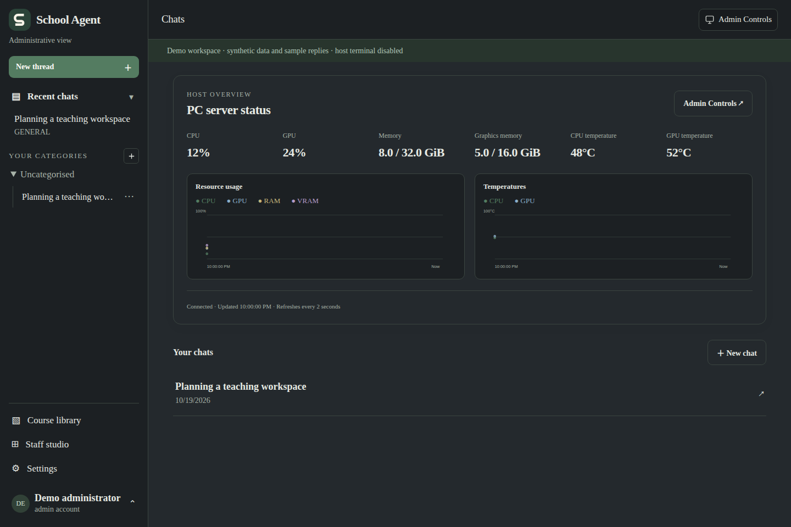
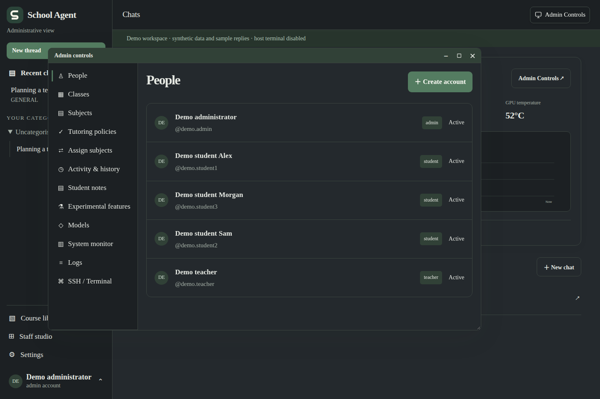
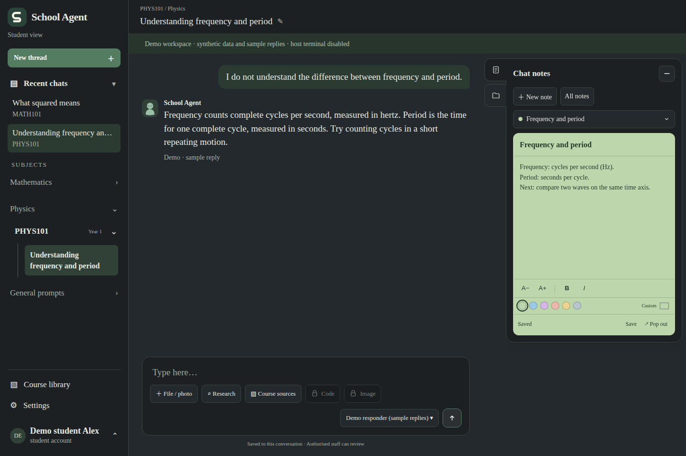
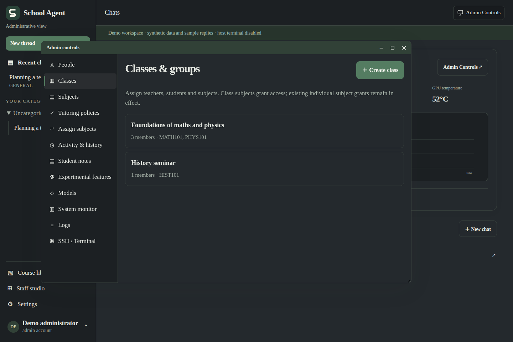
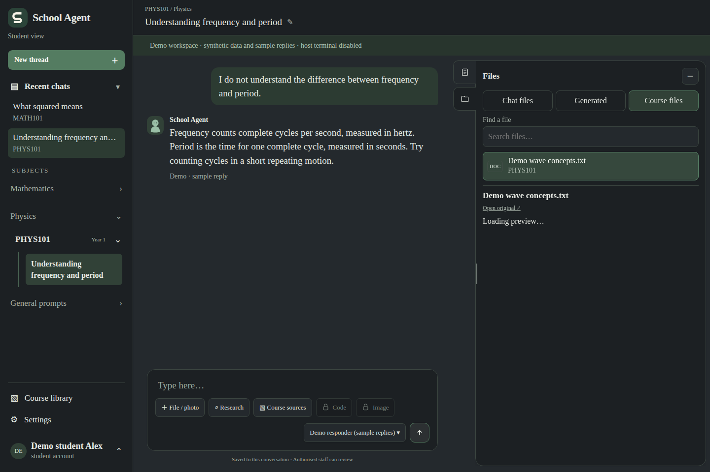
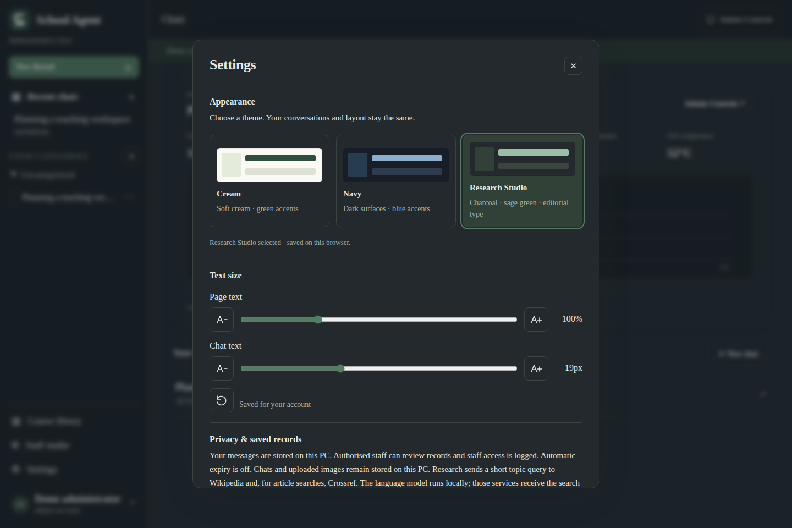

# School Agent

School Agent is a self-hosted AI workspace for students, teachers and administrators. It combines subject-based chat, shared teaching files, personal notes and class management in one browser interface. Replies run through locally downloaded models served by LM Studio; accounts and workspace data are stored in SQLite on the host.

**Current release:** [v0.2.1](https://github.com/slayadapraya/School-Agent/releases/tag/v0.2.1). This is a pilot application, with reviewed student tutoring and explicit role-based access.

## Features at a glance

| Feature                                   | What it provides                                                                                                        |
| ----------------------------------------- | ----------------------------------------------------------------------------------------------------------------------- |
| **Subject-based tutoring**                | Personal conversations organised by subject, with explanations, course references and configurable learning boundaries. |
| **Students, teachers and administrators** | Separate account roles, assigned teaching groups and server-checked access to records.                                  |
| **Classes and subject assignment**        | Manage rosters, teaching relationships, subject categories and course access.                                           |
| **Individual tutoring policies**          | Set installation defaults, class policies and per-person overrides from the admin panel.                                |
| **Chat notes**                            | Editable notes beside a conversation, colour and formatting controls, autosave and movable note windows.                |
| **Files and course sources**              | Upload study materials, share teaching files with classes and read supported documents beside the chat.                 |
| **Activity and history**                  | Search and filter records within the signed-in account's authorised review scope.                                       |
| **Local models**                          | Run downloaded models through LM Studio, with model access and prompt controls.                                         |
| **Desktop and mobile layouts**            | Responsive chat, an accessible mobile drawer, alternative themes and resizable workspace panels.                        |
| **Host administration**                   | Admin-only system monitoring, diagnostic logs and an embedded terminal in normal installations.                         |
| **Isolated public demo**                  | Sample accounts, classes, conversations and notes without using the live installation's data.                           |

## Workspace preview

These images show the current development workspace using **synthetic demo accounts
and conversations**. Hardware readings shown here are sample values. The latest
versioned release may differ from the development interface.

**Home screen** — recent conversations and the administrator's host overview.



**Admin panel** — manage people and their account roles.



**Chat and notes** — a subject conversation with its notes open beside it.



<details>
<summary><strong>More screenshots: classes, course files and appearance settings</strong></summary>

**Classes and groups**



**Course files**



**Appearance and text size**



</details>

## Try the demo

```bash
python3 -m pip install -r requirements.txt
python3 scripts/start-demo.py
```

Open **http://127.0.0.1:8140**. All five demo usernames and passwords are listed in
[DEMO_LOGINS.txt](DEMO_LOGINS.txt): an administrator, a teacher and three students.
The demo includes sample conversations, editable notes, two classes and a teaching file.
Two students belong to the teacher's class; the third demonstrates the separate class
access boundary. Administrator controls, account settings and policy changes are usable.

Demo mode creates its own **`.demo/`** workspace with a separate configuration copy and keeps edits between runs. It runs
on loopback, uses clearly labelled sample replies without a model download, and disables
the operating-system terminal. It leaves the normal **`.local/`** installation alone.
The public demo passwords do not apply to an ordinary installation or the live website.

For real model responses and the host terminal, use the normal installation below with
its separately generated credentials and configured local model. The demo needs Python
and Pillow; its sample text file does not require PDF extraction tools.

## What you can do

### Students

- Open an assigned subject, send a message to create a conversation, and rename or revisit that thread later.
- Ask for explanations, examples, definitions and help working through a problem. The tutor receives conversation context so follow-up questions can build on earlier messages.
- Upload a photo of a question or a supported document when account policy permits. Images use the configured vision model; extracted document text can inform the conversation.
- Read teaching files shared with your subject or class. Supported replies include clickable references that open the relevant passage and link to the original file.
- Keep permanent chat notes with titles, colours, text sizing and basic formatting. Notes autosave and can open in a floating window. Relevant personal notes can provide context to the assistant.
- Manage account memories and preferences, choose an interface theme, and recover deleted chats from Settings.

Student tutoring is designed to teach concepts and guide the next step rather than supply completed exercise answers. Context interpretation, response generation, model review and bounded numeric checks support that behaviour. Student restrictions still apply to additional models granted by a teacher. Review can fail, and model output can contain errors or disclose answers; it is not a guarantee.

### Teachers

- Work with assigned classes and their students, including subject assignment and permitted student history review.
- Review activity over a selected time period, filter records, inspect conversations and read student notes within the assigned roster.
- Publish teaching files to an assigned class through **Course library → Share a teaching file** or **Staff studio → Teaching files**.
- Archive or restore files they uploaded while they remain assigned to that class.
- Use available staff prompt and model-access controls. Actual permissions and class assignments are checked by the server.

### Administrators

- Create accounts, change Student/Teacher/Administrator roles, reset passwords, disable accounts and invalidate sessions.
- Create classes, assign teachers and students, add subjects, organise subject categories and assign course access.
- Edit classes and accounts in larger tabbed windows, with category tags, subject search, year filters, larger checkboxes and a persistent Save area. Individual account policies are available in **People → account → Policies**, alongside Details, Subjects and Tools.
- Configure tutoring policies at installation, class and individual levels. Factual overviews support On, Off and Inherit; the student default is Off. General factual background can be enabled without disabling exercise-answer restrictions or response review. Administrators have a separate personal assistant path.
- Search student activity, filter history and ask supported aggregate activity questions within the administrator's review scope.
- Select downloaded models, set personal instructions for each model and manage available model access. Models load when a new conversation first sends a message.
- Organise personal chats into custom categories with drag-and-drop ordering and recover deleted conversations.
- Switch to **Teacher view**, which changes the authenticated session role and blocks admin-only APIs, or use the student tutor preview. These previews do not impersonate a named student's account.
- Inspect application diagnostics and live CPU, RAM, GPU/VRAM, temperature and GPU power readings where the host exposes sensors, with recent-history graphs.
- Open an authenticated embedded host terminal. This is a shell on the server's operating system under its service account, not an SSH connection to another machine.

### Chat and interface

- Responsive desktop and mobile layouts, a left-side navigation drawer on phones, and a compact mobile composer.
- Dark green Research Studio styling plus alternative themes and theme typography in Settings.
- Streaming-style reply presentation, syntax-highlighted code, file downloads and a Stop control for active generation. Sent attachments leave the composer immediately; rejected sends restore the draft for retry.
- Click or keyboard-focus an admin, terminal or floating note window to bring it to the front.
- Subject conversations, recent chats, editable titles, personal files, account memories and permanent notes in the same workspace.
- Staff research routes can retrieve online sources and return linked references. Requested reference lists default to APA 7 unless another style is requested. Research depends on network access, available sources and the applicable role/policy path; the reviewed student tutor is not an unrestricted research assistant.

## Shared teaching files

1. A teacher opens **Course library → Share a teaching file** and selects a subject and an assigned class. An administrator may instead share with everyone enrolled in the subject.
2. The server extracts text, retains its location and indexes passages for retrieval within that subject.
3. A student asks a question in that subject's chat. Relevant accessible passages can be supplied to the main tutor as source material.
4. A source button below a supported reply opens the cited passage, with a link to the original document.

| Format               | Displayed location   | Limits and behaviour                                                          |
| -------------------- | -------------------- | ----------------------------------------------------------------------------- |
| PDF                  | Physical page number | Text-based, unlocked PDFs; up to 80 pages. Blank pages retain their position. |
| PowerPoint (`.pptx`) | Slide number         | Up to 120 slides, in presentation order.                                      |
| Word (`.docx`)       | Section number       | Logical text sections; document page numbers are not invented.                |
| Text / Markdown      | Section number       | UTF-8 text, split into logical sections.                                      |

Each teaching file may be up to **6 MB**, with at most **40 active files per subject**. Scanned PDFs and image-only slides need text recognition before upload. PDF extraction requires `pdfinfo` and `pdftotext` from Poppler.

Teachers publish to their assigned classes; students see only files available through current enrolment and class membership. Opening an original or an old citation checks access again. Archiving removes a file from new tutoring context while keeping it available to authorized readers of older citations; restoring enables retrieval again.

Retrieval currently uses lexical relevance and can miss paraphrases. Source links make passages inspectable; they do not independently verify every generated claim. Private alternative administrator models retain their separate chat path.

## Personal files and notes

Personal conversation documents are separate from shared teaching files. Chat uploads support PDF, DOCX, TXT, Markdown, CSV and JSON, alongside supported image attachments. Documents are limited to 6 MB and 20 per conversation; text extraction is bounded, so long documents may not all reach the model.

Notes and Files share a right-side pocket with two small edge buttons. Hover or keyboard-focus a button to reveal its label; tap it on mobile to open the panel. Switching folds the current card and slides the next into place. Minimise either panel to return that space to the desktop chat. Phones use a dismissible overlay.

Notes is a permanent feature, with autosave, local draft recovery, colour/formatting controls and floating note windows. The Experimental features tab remains available for future options. Personal notes belong to their author; authorized staff have read-only review access within their roster scope.

Files offers searchable **Chat files** and **Course files** collections. Preview images and PDFs, read extracted document text, jump to teaching-file pages/sections and open the original. Switching panels keeps the current note draft and file preview in place. File access is checked again on the server for every request.

## Access and data storage

| Role          | Personal workspace                    | Student records                                  | Teaching-file publishing            |
| ------------- | ------------------------------------- | ------------------------------------------------ | ----------------------------------- |
| Student       | Own chats, files, notes and memories  | Own records                                      | Read accessible subject/class files |
| Teacher       | Own workspace                         | Assigned students, subject to review permissions | Assigned classes                    |
| Administrator | Own workspace and administrator tools | Administrator review scope                       | Assigned classes or subject-wide    |

Students cannot request another person's chat, file or notes through client-supplied IDs or a claimed role. Roles, enrolment and class access are checked by the server. Teacher access does not grant access to another teacher's or administrator's personal chat history. Staff review actions are logged.

Private runtime data lives under `.local/` by default: database, accounts, saved files, notes, preferences and logs. It is excluded from Git and release source archives. Set `SCHOOL_AGENT_STATE` to use another state directory. Back up that directory separately from the source code.

Automatic age-based chat retention is disabled when `retention_days` is `null`. Deleted chats are recoverable through Settings. The initial `.local/credentials.json` contains generated first-run credentials; it does not track later password changes. Passwords must be reset rather than retrieved.

## Install and start

Requires **Python 3.11+**, **Pillow**, **Poppler** for PDF extraction, and **LM Studio** with a compatible downloaded model. The current configuration targets Qwen3.5 9B Q5; model downloads are separate from this repository. Host terminal and hardware monitoring support depends on the operating system and available tools/sensors; the service scripts target Linux.

```bash
git clone https://github.com/slayadapraya/School-Agent.git
cd School-Agent
python3 -m pip install -r requirements.txt
# Debian/Ubuntu: sudo apt-get install poppler-utils
# Configure config/settings.json and download the model in LM Studio.
./scripts/start-model.sh
./scripts/start.sh
```

Open **http://127.0.0.1:8137** and sign in using the first-run credentials generated on the host. For a project already installed as a user service:

```bash
systemctl --user start school-agent.service
systemctl --user status school-agent.service
# After updating Python source:
systemctl --user restart school-agent.service
```

To install that service on a new Linux host, run `./scripts/install-service.sh`. It starts the application and attempts to start the configured model. Check logs with `journalctl --user -u school-agent.service`.

### Public access

The optional public listener and Tailscale Funnel proxy require host configuration; cloning this repository does not create a public domain. Visitors using a configured Funnel address do not need Tailscale installed. The server PC and model service must remain available. Login is required on both listeners, and public sign-in applies stronger password requirements.

The repository includes `scripts/enable-public-access.sh` and `scripts/disable-public-access.sh`. Review listener and Tailscale settings for the destination host. Keep the model API local; expose the authenticated application rather than LM Studio directly.

## Configuration

| Path                              | Purpose                                                                           |
| --------------------------------- | --------------------------------------------------------------------------------- |
| `config/settings.json`            | Model URL/identifier, transport, context, listeners, research flags and retention |
| `config/courses.json`             | Base subject definitions and approved course material                             |
| `config/student-*.txt`            | Context interpretation, student tutoring and response-review defaults             |
| `config/conversation*.txt`        | General conversation and review defaults                                          |
| Other `config/*.json` / `*.txt`   | Source catalogues, concept guidance and research/planning instructions            |
| `.local/` or `SCHOOL_AGENT_STATE` | Private runtime data and saved overrides; excluded from version control           |

Staff prompt edits are stored in runtime data and can override file defaults. Refresh the browser after frontend updates; restart the service after Python changes. Hardware readings may be unavailable when a driver or sensor is unsupported. Image generation is not connected.

## Tests and evaluation

The release snapshot passed **196 automated tests**, including file access, class isolation, retained page/slide locations, archived references, student output boundaries and workspace ownership. The release workflow reruns the suite, formatting checks and JavaScript syntax checks before publishing.

```bash
python3 -m unittest discover -s tests
for file in app/static/*.js; do node --check "$file"; done
```

For a real-model evaluation, start the configured model first:

```bash
python3 scripts/evaluate_tutor.py --output /tmp/school-agent-evaluation.json
# Optional subset:
python3 scripts/evaluate_tutor.py --only material-frequency,material-page --output /tmp/citation-evaluation.json
```

This harness creates a disposable database and synthetic accounts, uploads its own fixtures, and makes 30 real HTTP chat requests. It does not open production chats, notes, saved prompts or student accounts. Cases cover conversation, subject concepts, follow-ups, an uploaded question image, privacy, answer boundaries and teaching-file citations. Keyword/boundary checks screen behaviour; read the replies to assess factual accuracy and teaching quality.

The October evaluation found missing file citations, which were fixed and passed a five-case retest. Manual review also found wording issues around economics terminology, claimed roles and source reliability. These remain areas for improvement; passing the software suite does not establish factual perfection.

## Editing the source

See [the editing guide](docs/EDITING.md) for a feature-to-file map, CSS theme variables,
script load order, note/panel lifecycle and formatting commands. Application source is
formatted with Black and Prettier, with module descriptions and named feature sections.
Vendor libraries remain in their original form. No frontend build is required.

## Releases

`VERSION` records the current semantic version. Each push to `main` triggers `.github/workflows/release.yml`: it runs the isolated tests and syntax checks, then publishes a GitHub release if that version does not already exist using the short notes in `docs/releases/v<VERSION>.md`. It can also be run manually from Actions. GitHub provides source ZIP and tar downloads for the version tag; model weights and runtime data are not included.
